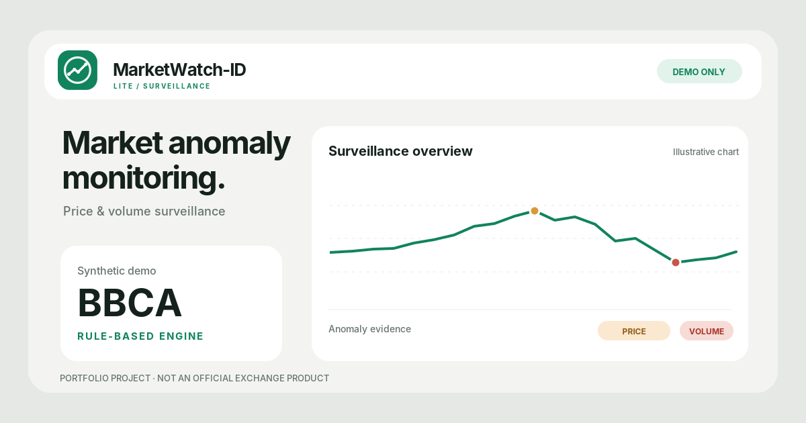

# MarketWatch-ID Lite

**Synthetic equity-market anomaly monitoring / Dashboard pemantauan anomali pasar saham berbasis data sintetis**

[**Live Dashboard**](https://market-watch-id-lite.vercel.app/) · [**GitHub Repository**](https://github.com/imamwijaya/MarketWatch-ID-Lite) · [**Backend Health Check**](https://marketwatch-id-lite-api.vercel.app/health)

**Language / Bahasa:** [English](#english) · [Bahasa Indonesia](#bahasa-indonesia)



> **Portfolio demonstration / Demonstrasi portofolio — synthetic data only / hanya data sintetis.** This project is an independent end-of-day prototype, not affiliated with the Indonesia Stock Exchange (IDX). It does not use live stock-market data or prove market manipulation. / Proyek ini merupakan prototipe end-of-day independen, tidak berafiliasi dengan Bursa Efek Indonesia (BEI), tidak menggunakan data pasar langsung, dan tidak membuktikan adanya manipulasi pasar.

---

## English

## Overview

MarketWatch-ID Lite explores how transparent, rule-based statistical checks can highlight unusual daily price movements and trading-volume spikes. It combines a reproducible synthetic dataset, a Python detection pipeline, a read-only FastAPI backend, and a responsive Next.js dashboard.

The application helps users inspect price and volume behavior, review classified alerts, and understand detection performance against known injected scenarios. **All displayed records use the synthetic symbol `BBCA_DEMO`, not historical BBCA trading data.**

## Live demo

**Dashboard:** https://market-watch-id-lite.vercel.app/

The deployed dashboard includes:

- Summary cards for observations, unique alerts, price alerts, and volume alerts.
- Closing-price and trading-volume charts with color-coded anomaly markers.
- Alert breakdown by classification and a filterable events table.
- Precision, recall, F1-score, confusion matrix, and evaluation coverage.
- Responsive layouts for desktop and mobile.

## Results on the synthetic dataset

| Metric | Result |
| --- | ---: |
| Synthetic observations | **140** |
| Evaluable observations | **119** |
| Injected anomaly scenarios | **3** |
| Unique detected alerts | **5** |
| `PRICE_ONLY` alerts | **3** |
| `VOLUME_ONLY` alerts | **1** |
| `COMBINED` alerts | **1** |
| Precision | **60.00%** |
| Recall | **100.00%** |
| F1-score | **75.00%** |
| Correct injected anomaly categories | **3 / 3** |

**Binary confusion matrix** (anomaly versus normal, on the 119 evaluable observations):

| Actual \\ Predicted | Normal | Anomaly |
| --- | ---: | ---: |
| Normal | 114 (TN) | 2 (FP) |
| Anomaly | 0 (FN) | 3 (TP) |

These are **demonstration-specific results** from deliberately injected anomalies. They are not performance estimates for real market surveillance.

## Detection methodology

The pipeline works on daily OHLCV records and uses a **20-observation historical baseline**. Baselines are shifted by one observation so the current day's value does not contribute to its own reference statistics.

**Price anomaly:** Compute a daily log return and its rolling Z-score against the preceding 20 log returns:

```text
log_return[t] = ln(close[t] / close[t-1])
price_zscore[t] = (log_return[t] - mean(previous 20 log returns))
                  / std(previous 20 log returns)
Price alert when abs(price_zscore[t]) >= 3
```

**Volume anomaly:** Compare the current day's volume to the median of the preceding 20 volumes:

```text
volume_ratio[t] = volume[t] / median(previous 20 volumes)
Volume alert when volume_ratio[t] >= 3
```

Each observation is assigned one mutually exclusive classification:

| Classification | Condition |
| --- | --- |
| `NORMAL` | Neither threshold is reached |
| `PRICE_ONLY` | Only the price threshold is reached |
| `VOLUME_ONLY` | Only the volume threshold is reached |
| `COMBINED` | Both thresholds are reached |

Observations without a complete valid baseline are excluded from performance evaluation. This implementation runs **offline on prepared CSV data**; it is not a real-time trading alert system.

## Architecture

```text
Synthetic OHLCV generator
        |
        v
 data/demo/demo_ohlcv.csv        data/demo/demo_labels.csv
        |                                  |
        v                                  |
 Python detection rules                    |
        |                                  |
        v                                  v
 data/demo/detection_results.csv ---> Evaluation logic
        |                                  |
        +----------------+-----------------+
                         |
                         v
                  FastAPI (Python)
          /api/observations | /api/alerts
                    /api/evaluation
                         |
                         v
              Next.js API routes / server
                         |
                         v
        React dashboard (Recharts + Tailwind)
```

### Technology stack

| Layer | Technologies |
| --- | --- |
| Data generation and detection | Python, NumPy, pandas |
| Evaluation and tests | Python, pytest |
| Backend API | FastAPI, Uvicorn |
| Frontend | Next.js 16, React 19, TypeScript |
| Visualization and styling | Recharts, Tailwind CSS |
| Hosting | Vercel (separate frontend and backend projects) |

## Project structure

```text
MarketWatch-ID-Lite/
├── app.py                         # FastAPI deployment entrypoint
├── app/dashboard.py               # Earlier Streamlit dashboard
├── backend/main.py                # Read-only FastAPI endpoints
├── data/demo/
│   ├── demo_ohlcv.csv             # Synthetic OHLCV observations
│   ├── demo_labels.csv            # Injected ground-truth scenarios
│   └── detection_results.csv      # Saved detector output
├── src/
│   ├── generate_demo_data.py
│   ├── validate_demo_data.py
│   ├── detect_price_anomaly.py
│   ├── detect_volume_anomaly.py
│   ├── detect_combined_anomaly.py
│   └── evaluate_detection.py
├── tests/                          # Dataset and evaluation tests
├── web/                            # Next.js frontend
│   └── src/
│       ├── app/                   # Pages and API proxy routes
│       ├── components/            # Charts, alerts, and KPIs
│       └── lib/                   # Shared data-fetching logic
├── requirements.txt
└── README.md
```

## Run locally

**Prerequisites:** Python 3.12, Node.js, and npm.

Clone the repository and set up Python from the project root:

```bash
git clone https://github.com/imamwijaya/MarketWatch-ID-Lite.git
cd MarketWatch-ID-Lite
python3 -m venv .venv
source .venv/bin/activate
pip install -r requirements.txt
```

Start the FastAPI backend in one terminal:

```bash
python -m uvicorn backend.main:app --reload --host 127.0.0.1 --port 8000
```

Start the Next.js frontend in another terminal:

```bash
cd web
npm ci
FASTAPI_URL=http://127.0.0.1:8000 npm run dev
```

Open **http://localhost:3000**. The backend runs at **http://127.0.0.1:8000**, and its interactive documentation is available at **http://127.0.0.1:8000/docs**.

### Reproduce the detection results

From the repository root, with the Python virtual environment active:

```bash
python src/generate_demo_data.py
python src/validate_demo_data.py
python src/detect_combined_anomaly.py
python src/evaluate_detection.py
python -m pytest tests/ -v
```

The generator uses a fixed random seed (`42`) and creates **140 simulated business-day observations** starting on January 2, 2025. It does not use the official IDX trading calendar. Regeneration writes to the tracked `data/demo/` CSV files.

## API reference

The read-only public backend is deployed at:

**https://marketwatch-id-lite-api.vercel.app**

| Endpoint | Purpose |
| --- | --- |
| [`GET /health`](https://marketwatch-id-lite-api.vercel.app/health) | API health and synthetic-demo mode |
| [`GET /api/observations`](https://marketwatch-id-lite-api.vercel.app/api/observations) | Daily observations, detection scores, and classifications |
| [`GET /api/alerts`](https://marketwatch-id-lite-api.vercel.app/api/alerts) | Only flagged observations |
| [`GET /api/evaluation`](https://marketwatch-id-lite-api.vercel.app/api/evaluation) | Evaluation metrics and confusion matrix |

The frontend is deployed separately on Vercel with the server-side environment variable:

```text
FASTAPI_URL=https://marketwatch-id-lite-api.vercel.app
```

## Scope and limitations

- **Synthetic records:** `BBCA_DEMO` is an invented demonstration symbol; no real BBCA price series is used.
- **Batch processing:** alerts are calculated from saved CSV outputs, not live exchange feeds.
- **Rule-based detection:** fixed thresholds may miss meaningful events or flag benign moves.
- **Synthetic evaluation:** ground truth consists of three deliberately injected scenarios; its metrics do not generalize to production environments.
- **Not an official surveillance tool:** alerts are indicators for exploration, not findings of misconduct or investment advice.

## Project status

**MVP completed:** Python data pipeline, FastAPI backend, responsive Next.js dashboard, API integration, and public Vercel deployments.

**Live dashboard:** https://market-watch-id-lite.vercel.app/

**Repository:** https://github.com/imamwijaya/MarketWatch-ID-Lite

---

## Bahasa Indonesia

## Ringkasan

MarketWatch-ID Lite merupakan prototipe dashboard pemantauan anomali pasar saham menggunakan **data sintetis**, yang menggabungkan pemeriksaan statistik berbasis aturan (*rule-based*), pipeline Python, backend FastAPI, dan frontend Next.js yang responsif.

Aplikasi ini memungkinkan pengguna memeriksa pergerakan harga penutupan, lonjakan volume perdagangan, klasifikasi peringatan, serta hasil evaluasi deteksi berdasarkan skenario anomali yang sengaja disisipkan. **Seluruh data menggunakan simbol sintetis `BBCA_DEMO`, bukan riwayat perdagangan saham BBCA yang sebenarnya.**

## Demo aplikasi

**Dashboard:** https://market-watch-id-lite.vercel.app/

Fitur yang tersedia:

- Kartu ringkasan jumlah observasi, peringatan unik, peringatan harga, dan peringatan volume.
- Grafik harga penutupan dan volume dengan penanda anomali berwarna.
- Distribusi kategori peringatan dan tabel kejadian dengan filter.
- Precision, recall, F1-score, confusion matrix, dan cakupan evaluasi.
- Tampilan responsif untuk desktop maupun perangkat seluler.

## Hasil pada dataset sintetis

| Metrik | Hasil |
| --- | ---: |
| Jumlah observasi sintetis | **140** |
| Observasi yang dapat dievaluasi | **119** |
| Skenario anomali yang disisipkan | **3** |
| Peringatan unik yang terdeteksi | **5** |
| Peringatan `PRICE_ONLY` | **3** |
| Peringatan `VOLUME_ONLY` | **1** |
| Peringatan `COMBINED` | **1** |
| Precision | **60,00%** |
| Recall | **100,00%** |
| F1-score | **75,00%** |
| Kategori anomali sisipan terklasifikasi benar | **3 / 3** |

**Confusion matrix biner** (anomali versus normal, untuk 119 observasi yang dapat dievaluasi):

| Aktual \\ Prediksi | Normal | Anomali |
| --- | ---: | ---: |
| Normal | 114 (TN) | 2 (FP) |
| Anomali | 0 (FN) | 3 (TP) |

Angka tersebut merupakan **hasil demonstrasi pada skenario sintetis** yang telah ditentukan. Angka ini tidak dapat dianggap sebagai estimasi performa sistem pengawasan pasar saham nyata.

## Metodologi deteksi

Pipeline memproses data OHLCV harian menggunakan **baseline historis sepanjang 20 observasi**. Baseline digeser satu observasi agar nilai pada hari yang sedang diperiksa tidak ikut menghitung statistik acuannya.

**Anomali harga:** Hitung *log return* harian dan *rolling Z-score* berdasarkan 20 *log return* sebelumnya:

```text
log_return[t] = ln(close[t] / close[t-1])
price_zscore[t] = (log_return[t] - mean(previous 20 log returns))
                  / std(previous 20 log returns)
Peringatan harga jika abs(price_zscore[t]) >= 3
```

**Anomali volume:** Bandingkan volume hari ini dengan median 20 volume sebelumnya:

```text
volume_ratio[t] = volume[t] / median(previous 20 volumes)
Peringatan volume jika volume_ratio[t] >= 3
```

Setiap observasi memiliki satu klasifikasi yang saling eksklusif:

| Klasifikasi | Kondisi |
| --- | --- |
| `NORMAL` | Tidak ada ambang batas yang terlampaui |
| `PRICE_ONLY` | Hanya ambang batas harga yang terlampaui |
| `VOLUME_ONLY` | Hanya ambang batas volume yang terlampaui |
| `COMBINED` | Kedua ambang batas terlampaui |

Observasi tanpa baseline valid yang lengkap dikeluarkan dari evaluasi performa. Implementasi ini berjalan **secara batch/offline pada data CSV yang telah disiapkan**, bukan sebagai sistem peringatan transaksi real-time.

## Arsitektur sistem

```text
Generator OHLCV sintetis
        |
        v
 data/demo/demo_ohlcv.csv        data/demo/demo_labels.csv
        |                                  |
        v                                  |
 Aturan deteksi Python                    |
        |                                  |
        v                                  v
 data/demo/detection_results.csv ---> Logika evaluasi
        |                                  |
        +----------------+-----------------+
                         |
                         v
                  FastAPI (Python)
          /api/observations | /api/alerts
                    /api/evaluation
                         |
                         v
               Next.js API routes / server
                         |
                         v
       Dashboard React (Recharts + Tailwind)
```

### Teknologi yang digunakan

| Bagian | Teknologi |
| --- | --- |
| Generasi data dan deteksi | Python, NumPy, pandas |
| Evaluasi dan pengujian | Python, pytest |
| Backend API | FastAPI, Uvicorn |
| Frontend | Next.js 16, React 19, TypeScript |
| Visualisasi dan styling | Recharts, Tailwind CSS |
| Hosting | Vercel (frontend dan backend sebagai dua proyek terpisah) |

## Struktur proyek

```text
MarketWatch-ID-Lite/
├── app.py                         # Entrypoint FastAPI untuk Vercel
├── app/dashboard.py               # Dashboard Streamlit versi awal
├── backend/main.py                # Endpoint FastAPI read-only
├── data/demo/
│   ├── demo_ohlcv.csv             # Observasi OHLCV sintetis
│   ├── demo_labels.csv            # Label skenario anomali sisipan
│   └── detection_results.csv      # Hasil deteksi yang disimpan
├── src/
│   ├── generate_demo_data.py
│   ├── validate_demo_data.py
│   ├── detect_price_anomaly.py
│   ├── detect_volume_anomaly.py
│   ├── detect_combined_anomaly.py
│   └── evaluate_detection.py
├── tests/                          # Pengujian dataset dan evaluasi
├── web/                            # Frontend Next.js
│   └── src/
│       ├── app/                   # Halaman dan API proxy routes
│       ├── components/            # Grafik, alert, dan KPI
│       └── lib/                   # Logika pengambilan data bersama
├── requirements.txt
└── README.md
```

## Menjalankan secara lokal

**Prasyarat:** Python 3.12, Node.js, dan npm.

Kloning repository dan siapkan lingkungan Python dari folder utama proyek:

```bash
git clone https://github.com/imamwijaya/MarketWatch-ID-Lite.git
cd MarketWatch-ID-Lite
python3 -m venv .venv
source .venv/bin/activate
pip install -r requirements.txt
```

Jalankan backend FastAPI di terminal pertama:

```bash
python -m uvicorn backend.main:app --reload --host 127.0.0.1 --port 8000
```

Jalankan frontend Next.js di terminal kedua:

```bash
cd web
npm ci
FASTAPI_URL=http://127.0.0.1:8000 npm run dev
```

Buka **http://localhost:3000**. Backend berjalan pada **http://127.0.0.1:8000**, dengan dokumentasi API interaktif di **http://127.0.0.1:8000/docs**.

### Mereproduksi hasil deteksi

Dari folder utama proyek, dengan *virtual environment* Python aktif:

```bash
python src/generate_demo_data.py
python src/validate_demo_data.py
python src/detect_combined_anomaly.py
python src/evaluate_detection.py
python -m pytest tests/ -v
```

Generator menggunakan *random seed* tetap (`42`) dan menghasilkan **140 observasi hari kerja simulasi** mulai 2 Januari 2025. Generator tidak menggunakan kalender perdagangan resmi IDX. Proses regenerasi akan menulis ulang file CSV yang dilacak Git di `data/demo/`.

## Referensi API

Backend publik *read-only* tersedia di:

**https://marketwatch-id-lite-api.vercel.app**

| Endpoint | Fungsi |
| --- | --- |
| [`GET /health`](https://marketwatch-id-lite-api.vercel.app/health) | Status API dan mode demo sintetis |
| [`GET /api/observations`](https://marketwatch-id-lite-api.vercel.app/api/observations) | Data harian, skor deteksi, dan klasifikasi |
| [`GET /api/alerts`](https://marketwatch-id-lite-api.vercel.app/api/alerts) | Observasi yang ditandai sebagai anomali |
| [`GET /api/evaluation`](https://marketwatch-id-lite-api.vercel.app/api/evaluation) | Metrik evaluasi dan confusion matrix |

Frontend di-deploy sebagai proyek Vercel terpisah dengan environment variable pada sisi server:

```text
FASTAPI_URL=https://marketwatch-id-lite-api.vercel.app
```

## Ruang lingkup dan keterbatasan

- **Data sintetis:** `BBCA_DEMO` adalah simbol rekaan untuk demonstrasi; tidak ada data historis BBCA asli yang digunakan.
- **Pemrosesan batch:** peringatan berasal dari hasil CSV yang tersimpan, bukan dari umpan data bursa secara langsung.
- **Aturan statistik tetap:** ambang batas yang digunakan dapat melewatkan peristiwa penting atau menandai pergerakan yang sebenarnya wajar.
- **Evaluasi sintetis:** *ground truth* dibentuk dari tiga skenario anomali yang sengaja disisipkan; hasilnya tidak otomatis berlaku pada lingkungan produksi.
- **Bukan alat pengawasan resmi:** peringatan bersifat indikator eksploratif, bukan bukti pelanggaran pasar atau rekomendasi investasi.

## Status proyek

**MVP selesai:** Pipeline Python, backend FastAPI, dashboard Next.js responsif, integrasi API, dan deployment publik di Vercel.

**Live dashboard:** https://market-watch-id-lite.vercel.app/

**Repository:** https://github.com/imamwijaya/MarketWatch-ID-Lite
